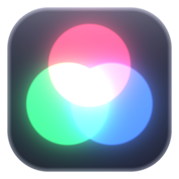
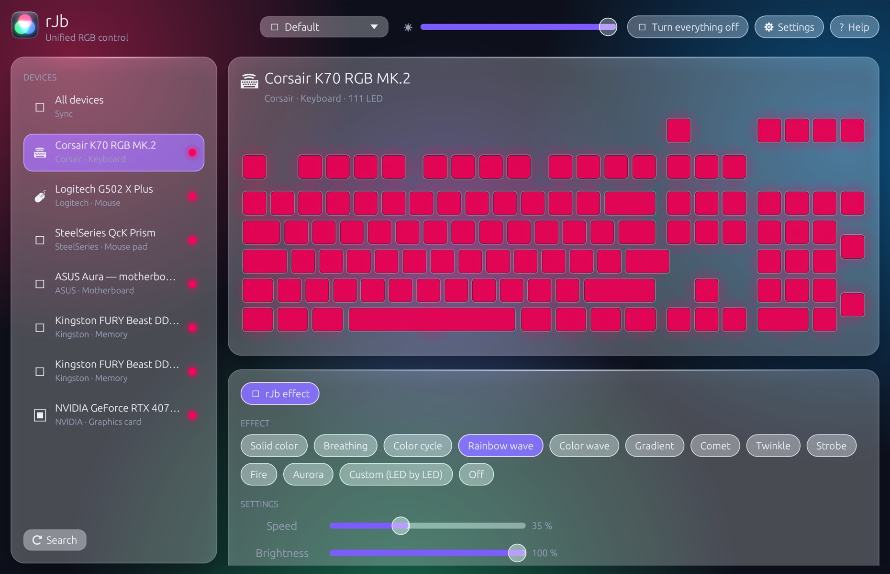
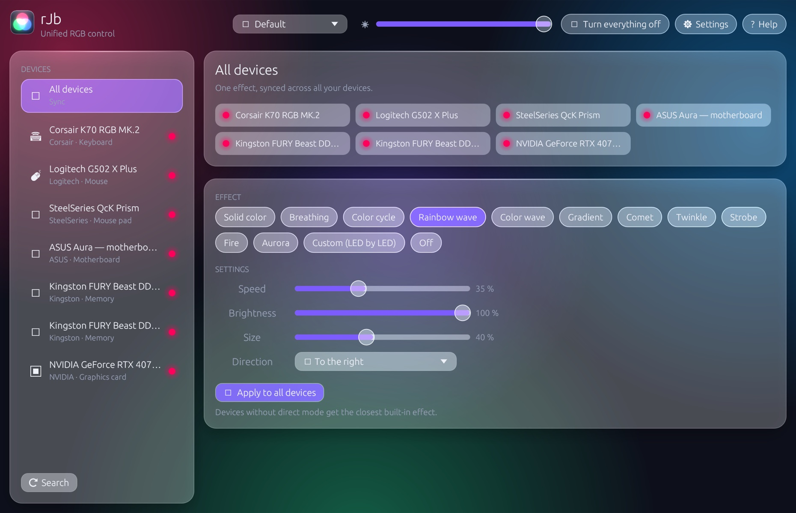
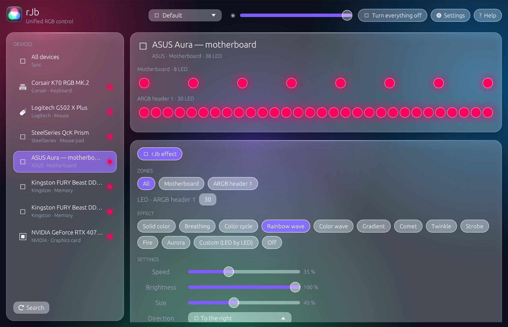
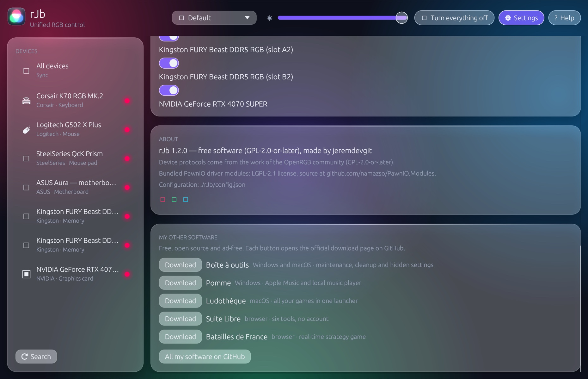

<p align="center"></p>

# rJb

[English](README.md) · [Français](README.fr.md) · **Español**

**La iluminación RGB de todos tus periféricos y componentes en una sola aplicación ligera para Windows.** Teclados, ratones, auriculares, alfombrillas, memoria RAM, placa base, tarjeta gráfica, ventiladores y tiras LED: un solo efecto sincronizado, sin los pesados programas de cada fabricante.

**8 idiomas**: español, inglés, francés, alemán, italiano, portugués, chino y japonés. El idioma de Windows se elige automáticamente; *Ajustes › Idioma* permite cambiarlo (al instante, sin reiniciar).

👉 **[Descargar rJb para Windows](https://github.com/jeremdevgit/rjb/releases/latest)** (`rJb-Setup.exe`)



<p> </p>
<p></p>

*Capturas realizadas con dispositivos de demostración: interfaz real y motor de efectos real, sin hardware conectado.*

## Dispositivos compatibles

| Familia | Ejemplos |
|---|---|
| Teclados, ratones, auriculares, alfombrillas | Logitech, Corsair, Razer, SteelSeries, HyperX, Wooting, dispositivos «Iluminación dinámica» / LampArray de Windows |
| Memoria RAM | Corsair, Kingston Fury, HyperX, Crucial Ballistix, G.Skill y otros módulos ENE / SPD |
| Placas base y controladores | ASUS Aura (USB), MSI Mystic Light, Gigabyte RGB Fusion 2, ASRock Polychrome, Corsair Commander Core / Lighting Node / Hydro Platinum, NZXT Hue 2, Lian Li |
| Tarjetas gráficas | NVIDIA (mediante el controlador de NVIDIA) y controladores de los fabricantes de tarjetas |

La memoria y la placa base pasan por el bus SMBus, gracias al controlador firmado y libre **PawnIO** (el mismo que usan OpenRGB y FanControl), que el instalador instala de forma opcional. Sin él, solo se controlan los dispositivos USB.

## Funciones

- 12 efectos sincronizados en todos los dispositivos: color fijo, respiración, ciclo de colores, onda arcoíris, onda de colores, degradado, cometa, centelleo, estroboscopio, fuego, aurora y ajuste LED por LED; brillo global, dispositivos ignorados.
- Perfiles, inicio con el sistema (con los permisos necesarios para la RAM y la placa base), área de notificación.
- Detección de programas competidores (G HUB, iCUE, Synapse, Armoury Crate, SignalRGB, OpenRGB…) que se disputan los mismos dispositivos.

## Instalar

1. Descarga `rJb-Setup.exe` desde las [Releases](https://github.com/jeremdevgit/rjb/releases/latest) y ejecútalo.
2. **Una versión ya instalada se reemplaza automáticamente** (se eliminan los archivos de la versión anterior, aunque estuviera en otra carpeta); se conservan los perfiles y los ajustes.
3. rJb se instala en *Archivos de programa*: la tarea que lo inicia como administrador al iniciar sesión solo se crea en una carpeta que únicamente los administradores pueden modificar.

El ejecutable no está firmado con un certificado de pago: si Windows SmartScreen muestra «Windows protegió su PC», haz clic en **Más información** y luego en **Ejecutar de todas formas**. Para verificar el archivo: `Get-FileHash .\rJb-Setup.exe` y compáralo con `SHA256SUMS.txt`.

## Privacidad y seguridad

- **Ninguna conexión de red** (salvo la instalación opcional de PawnIO mediante winget y los enlaces abiertos en tu navegador), ninguna telemetría.
- Acceso al bus SMBus compartido con los demás programas mediante el bloqueo habitual del sistema; escrituras limitadas a las direcciones de los controladores reconocidos.
- Enlaces externos abiertos con los permisos del usuario, nunca como administrador.

¿Has encontrado una vulnerabilidad? Lee [SECURITY.md](SECURITY.md).

## Compilar

Requisitos: [Rust](https://rustup.rs) estable y las *Build Tools* de Visual Studio («Desarrollo para el escritorio con C++»).

```powershell
cargo build --release          # target\release\rJb.exe (renombrado rJb-Setup.exe, instala)
.\tools\release.ps1            # dist\rJb-Setup.exe + comprobaciones
```

Las versiones publicadas se compilan con GitHub Actions ([`.github/workflows/windows.yml`](.github/workflows/windows.yml)).

## Traducciones

Los textos están en [`src/textes.rs`](src/textes.rs): una línea por texto, con el francés como clave, seguido de las siete traducciones. El inglés se usa como respaldo cuando el idioma de Windows no está disponible. Para el chino y el japonés se carga la fuente de Windows correspondiente (Microsoft YaHei, Yu Gothic…).

## Estructura del repositorio

```
src/drivers/   un controlador por familia de dispositivos (HID, SMBus, NVAPI…)
src/           motor de efectos, configuración, interfaz (egui), instalador
assets/pawnio/ módulos compilados del controlador PawnIO (acceso SMBus)
tools/         compilación de la versión distribuida
licences-tiers/ licencias de los componentes de terceros
```

## Licencia

Código bajo licencia **GNU GPL v2 o posterior**: consulta [LICENSE](LICENSE). Copyright © 2026 jeremdevgit.

Los protocolos de los dispositivos proceden del trabajo de la comunidad [OpenRGB](https://gitlab.com/CalcProgrammer1/OpenRGB) (GPL-2.0-or-later), de ahí la licencia de rJb. Los módulos [PawnIO](https://github.com/namazso/PawnIO.Modules) incluidos están bajo licencia LGPL-2.1 (carpeta [licences-tiers](licences-tiers/)). Las marcas citadas pertenecen a sus propietarios; rJb no está afiliado a ningún fabricante.

## Mis otros programas

Todos libres, gratuitos y sin publicidad — [github.com/jeremdevgit](https://github.com/jeremdevgit):

| Programa | Plataforma | En resumen |
|---|---|---|
| [AutoDex](https://github.com/jeremdevgit/autodex) | Windows, macOS, Linux | Juego de colección de coches con reconocimiento de fotos en el dispositivo |
| [Boîte à outils](https://github.com/jeremdevgit/boite-a-outils) | Windows, macOS | Mantenimiento del ordenador, limpieza y búsqueda de archivos |
| [Carnet de notes](https://github.com/jeremdevgit/carnet-rust) | Windows | Cuadernos cifrados y sincronización experimental |
| [Decklight](https://github.com/jeremdevgit/decklight) | Windows, macOS, Linux | Stream Deck virtual con control USB |
| [JMeca](https://github.com/jeremdevgit/jmeca) | Windows, macOS, Linux | Seguimiento de mantenimiento de vehículos cifrado |
| [LJ Hub](https://github.com/jeremdevgit/lj-hub) | Windows, macOS, Linux | Gestor de perfiles para dispositivos Logitech |
| [Pomme](https://github.com/jeremdevgit/pomme) | Windows | Reproductor de música para Apple Music y archivos locales |
| [Ludothèque](https://github.com/jeremdevgit/ludotheque) | macOS | Biblioteca y lanzador de juegos |
| [Suite Libre](https://jeremdevgit.github.io/suite-libre/) | Navegador | Seis herramientas sin cuenta |
| [Batailles de France](https://github.com/jeremdevgit/batailles-de-france) | Navegador | Juego de estrategia en tiempo real |
