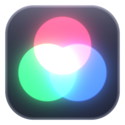
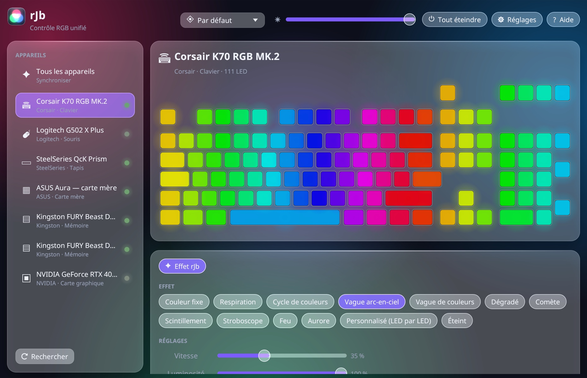
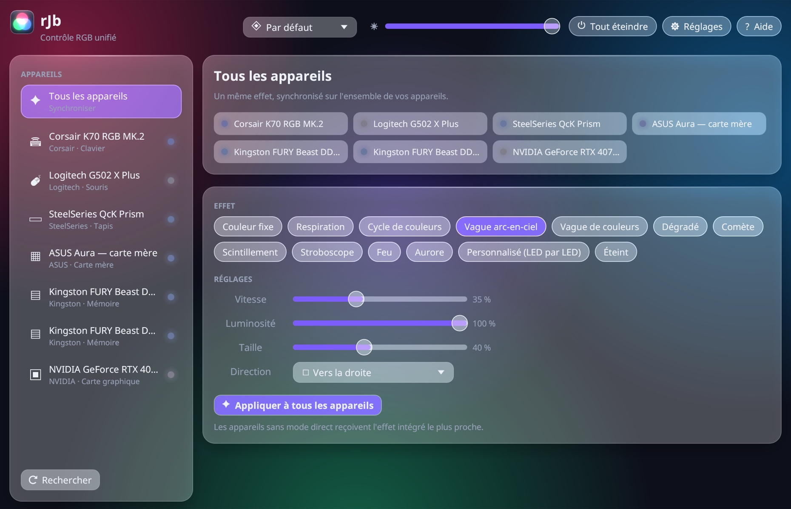
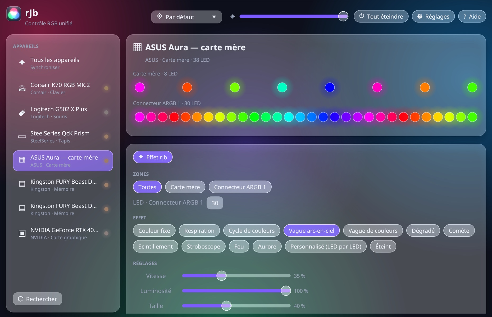
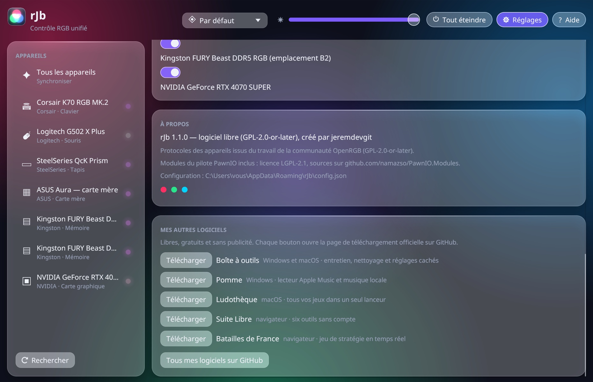

<p align="center"></p>

# rJb

[English](README.md) · **Français** · [Español](README.es.md)

**L'éclairage RGB de tous tes périphériques et composants dans une seule application légère pour Windows.** Claviers, souris, casques, tapis, mémoire vive, carte mère, carte graphique, ventilateurs et bandeaux : un seul effet synchronisé, sans les logiciels lourds de chaque fabricant.

**8 langues** : français, anglais, espagnol, allemand, italien, portugais, chinois et japonais. La langue de Windows est choisie automatiquement ; *Réglages › Langue* permet d'en changer (immédiatement, sans relancer).

👉 **[Télécharger rJb pour Windows](https://github.com/jeremdevgit/rjb/releases/latest)** (`rJb-Setup.exe`)



<p> </p>
<p></p>

*Captures réalisées avec des appareils de démonstration : vraie interface et vrai moteur d'effets, sans matériel branché.*

## Appareils pris en charge

| Famille | Exemples |
|---|---|
| Claviers, souris, casques, tapis | Logitech, Corsair, Razer, SteelSeries, HyperX, Wooting, appareils « Dynamic Lighting » / LampArray de Windows |
| Mémoire vive | Corsair, Kingston Fury, HyperX, Crucial Ballistix, G.Skill et autres modules ENE / SPD |
| Cartes mères et contrôleurs | ASUS Aura (USB), MSI Mystic Light, Gigabyte RGB Fusion 2, ASRock Polychrome, Corsair Commander Core / Lighting Node / Hydro Platinum, NZXT Hue 2, Lian Li |
| Cartes graphiques | NVIDIA (via le pilote NVIDIA) et contrôleurs des fabricants de cartes |

La mémoire et la carte mère passent par le bus SMBus, grâce au pilote signé et libre **PawnIO** (le même qu'OpenRGB et FanControl), installé en option par l'installateur. Sans lui, seuls les appareils USB sont pilotés.

## Fonctionnalités

- 12 effets synchronisés sur tous les appareils : couleur fixe, respiration, cycle de couleurs, vague arc-en-ciel, vague de couleurs, dégradé, comète, scintillement, stroboscope, feu, aurore, et réglage LED par LED ; luminosité globale, appareils ignorés.
- Profils, lancement au démarrage (avec les droits nécessaires pour la RAM et la carte mère), zone de notification.
- Détection des logiciels concurrents (G HUB, iCUE, Synapse, Armoury Crate, SignalRGB, OpenRGB…) qui se disputent les mêmes appareils.

## Installer

1. Télécharge `rJb-Setup.exe` dans les [Releases](https://github.com/jeremdevgit/rjb/releases/latest) et lance-le.
2. **Une version déjà installée est remplacée automatiquement** (fichiers de l'ancienne version retirés, y compris si elle était dans un autre dossier) ; profils et réglages conservés.
3. rJb s'installe dans *Program Files* : la tâche qui le lance en administrateur à l'ouverture de session n'est créée que dans un dossier que seuls les administrateurs peuvent modifier.

L'exécutable n'est pas signé par un certificat payant : si Windows SmartScreen affiche « Windows a protégé votre ordinateur », clique sur **Informations complémentaires** puis **Exécuter quand même**. Pour vérifier le fichier : `Get-FileHash .\rJb-Setup.exe` et compare avec `SHA256SUMS.txt`.

## Vie privée et sécurité

- **Aucune connexion réseau** (hormis l'installation optionnelle de PawnIO par winget et les liens ouverts dans ton navigateur), aucune télémétrie.
- Accès au bus SMBus partagé avec les autres logiciels par le verrou système habituel ; écritures limitées aux adresses des contrôleurs reconnus.
- Liens externes ouverts avec les droits de l'utilisateur, jamais en administrateur.

Une faille ? Merci de lire [SECURITY.md](SECURITY.md).

## Compiler

Prérequis : [Rust](https://rustup.rs) stable et les *Build Tools* de Visual Studio (« Développement Desktop en C++ »).

```powershell
cargo build --release          # target\release\rJb.exe (renommé rJb-Setup.exe, il installe)
.\tools\release.ps1            # dist\rJb-Setup.exe + contrôles
```

Les versions publiées sont construites par GitHub Actions ([`.github/workflows/windows.yml`](.github/workflows/windows.yml)).

## Traductions

Les textes sont dans [`src/textes.rs`](src/textes.rs) : une ligne par texte, le français servant de clé, suivi des sept traductions. L'anglais sert de repli quand la langue de Windows n'est pas proposée. Pour le chinois et le japonais, la police de Windows correspondante est chargée (Microsoft YaHei, Yu Gothic…).

## Structure du dépôt

```
src/drivers/   un pilote par famille d'appareils (HID, SMBus, NVAPI…)
src/           moteur d'effets, configuration, interface (egui), installateur
assets/pawnio/ modules compilés du pilote PawnIO (accès SMBus)
tools/         construction de la version distribuée
licences-tiers/ licences des composants tiers
```

## Licence

Code sous licence **GNU GPL v2 ou ultérieure** — voir [LICENSE](LICENSE). Copyright © 2026 jeremdevgit.

Les protocoles des appareils sont issus du travail de la communauté [OpenRGB](https://gitlab.com/CalcProgrammer1/OpenRGB) (GPL-2.0-or-later), d'où la licence de rJb. Les modules [PawnIO](https://github.com/namazso/PawnIO.Modules) inclus sont sous licence LGPL-2.1 (dossier [licences-tiers](licences-tiers/)). Les marques citées appartiennent à leurs propriétaires ; rJb n'est affilié à aucun fabricant.

## Mes autres logiciels

Tous libres, gratuits et sans publicité — [github.com/jeremdevgit](https://github.com/jeremdevgit) :

| Logiciel | Pour | En bref |
|---|---|---|
| [Boîte à outils](https://github.com/jeremdevgit/boite-a-outils) | Windows, macOS | entretien, nettoyage et réglages cachés |
| [Pomme](https://github.com/jeremdevgit/pomme) | Windows | lecteur Apple Music et musique locale |
| [Ludothèque](https://github.com/jeremdevgit/ludotheque) | macOS | tous tes jeux dans un seul lanceur |
| [Suite Libre](https://jeremdevgit.github.io/suite-libre/) | navigateur | six outils sans compte : QR codes, flou, photos, conversions, moyennes, mots de passe |
| [Batailles de France](https://github.com/jeremdevgit/batailles-de-france) | navigateur | jeu de stratégie en temps réel sur les cartes de cinq villes |

