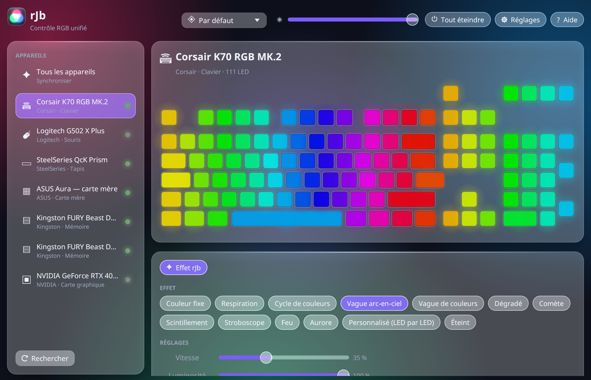
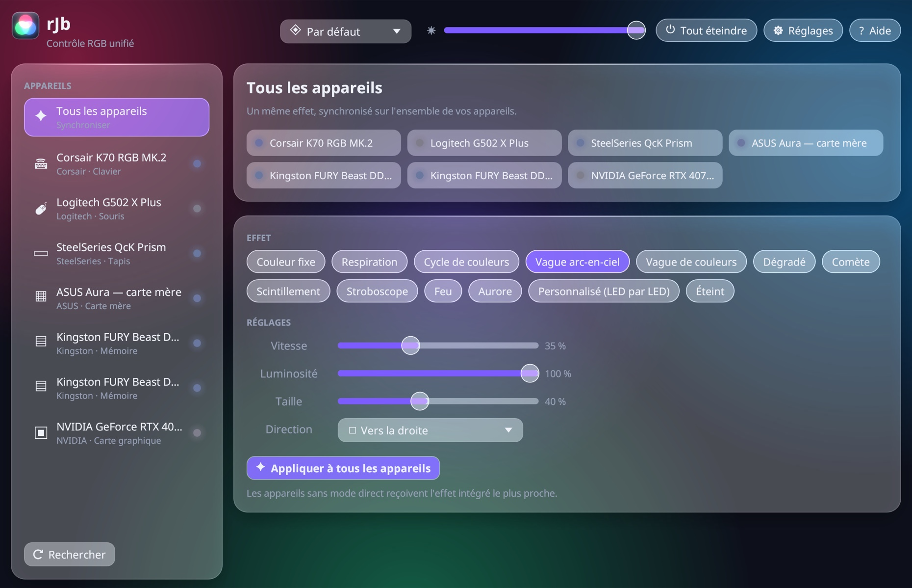
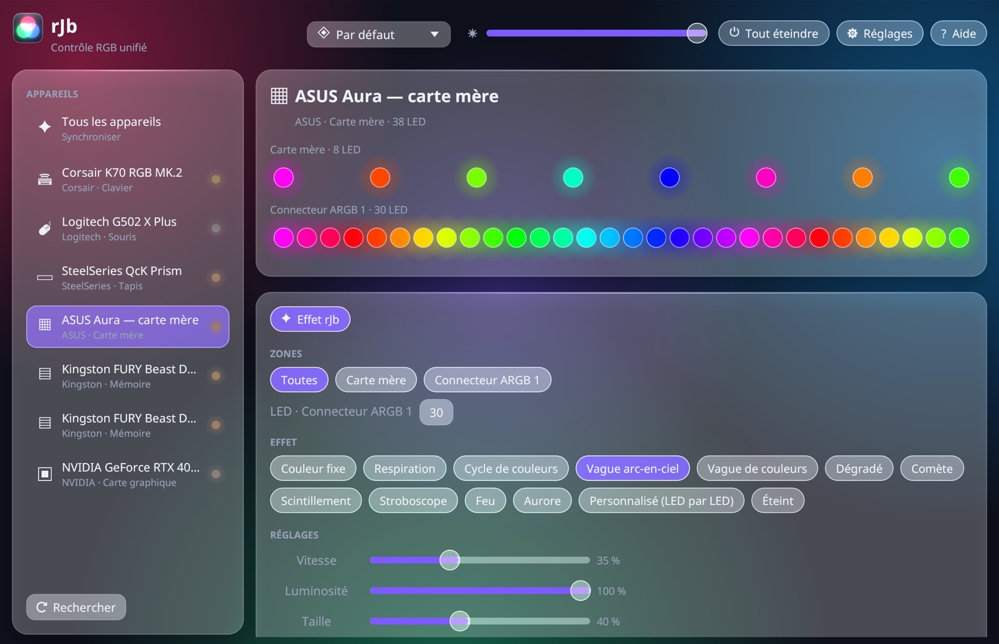

<p align="center"></p>

<h1 align="center">rJb</h1>

<p align="center"><b>L'éclairage RVB de tous vos périphériques et composants dans une seule application légère.</b></p>

<p align="center"> <a href="https://github.com/jeremdevgit/rjb/releases"></a> <a href="LICENSE"></a> <a href="https://github.com/jeremdevgit/rjb/actions/workflows/windows.yml"></a></p>

<p align="center"><a href="README.md">English</a> · <b>Français</b> · <a href="README.es.md">Español</a> · <a href="README.de.md">Deutsch</a> · <a href="README.it.md">Italiano</a> · <a href="README.pt.md">Português</a> · <a href="README.zh.md">简体中文</a> · <a href="README.ja.md">日本語</a></p>

<p align="center"><a href="https://github.com/jeremdevgit/rjb/releases/latest"><b>⬇ Télécharger</b></a></p>



Claviers, souris, casques, tapis, mémoire vive, carte mère, carte graphique, ventilateurs et bandeaux LED : **un seul effet synchronisé, sans les logiciels lourds de chaque fabricant.**

<p> </p>

*Captures réalisées avec des appareils de démonstration, la vraie interface et le vrai moteur d'effets.*

## En bref

| | |
|---|---|
| **Catégorie** | 🛠️ Système et matériel |
| **Plateformes** | Windows |
| **Interface** | 8 langues (EN, FR, ES, DE, IT, PT, ZH, JA) |
| **Prix** | Gratuit, open source, sans publicité ni télémétrie |
| **État** | Stable |
| **Licence** | [GPL-2.0-or-later](LICENSE) |

## Ce qu'il fait

- **12 effets synchronisés** : couleur fixe, respiration, cycle de couleurs, vague arc-en-ciel, vague de couleur, dégradé, comète, scintillement, stroboscope, feu, aurore et édition LED par LED ; luminosité globale, appareils ignorés.
- **Profils**, lancement à l'ouverture de session (avec les droits nécessaires pour la RAM et la carte mère), icône dans la zone de notification.
- **Détection des conflits** : prévient quand G HUB, iCUE, Synapse, Armoury Crate, SignalRGB ou OpenRGB se disputent les mêmes appareils.

## Matériel pris en charge

| Famille | Exemples |
|---|---|
| Claviers, souris, casques, tapis | Logitech, Corsair, Razer, SteelSeries, HyperX, Wooting, éclairage dynamique Windows (LampArray) |
| Mémoire vive | Corsair, Kingston Fury, HyperX, Crucial Ballistix, G.Skill et autres modules ENE / SPD |
| Cartes mères et contrôleurs | ASUS Aura (USB), MSI Mystic Light, Gigabyte RGB Fusion 2, ASRock Polychrome, Corsair Commander Core / Lighting Node / Hydro Platinum, NZXT Hue 2, Lian Li |
| Cartes graphiques | NVIDIA (via le pilote) et contrôleurs des fabricants de cartes |

La RAM et la carte mère passent par le bus SMBus grâce au pilote libre et signé **PawnIO** (le même qu'OpenRGB et FanControl), proposé par l'installateur. Sans lui, seuls les appareils USB sont pilotés.

## Installer

1. Téléchargez `rJb-Setup.exe` depuis la [dernière version](https://github.com/jeremdevgit/rjb/releases/latest) et lancez-le.
2. Une version installée est remplacée automatiquement ; profils et réglages sont conservés.
3. rJb s'installe dans *Program Files* : la tâche lancée en administrateur à l'ouverture de session pointe vers un dossier modifiable seulement par les administrateurs.

Pas de certificat payant : si SmartScreen s'affiche, choisissez **Informations complémentaires › Exécuter quand même**. Vérifiez avec `Get-FileHash .\rJb-Setup.exe` et `SHA256SUMS.txt`.

## Sécurité et confidentialité

- **Aucune connexion réseau** (hors installation facultative de PawnIO via winget et liens que vous ouvrez), aucune télémétrie.
- L'accès SMBus partage le verrou système habituel avec les autres logiciels ; les écritures sont limitées aux adresses des contrôleurs reconnus.
- Les liens externes s'ouvrent avec vos droits, jamais en administrateur.

## Compiler

```powershell
# Rust stable + Visual Studio Build Tools (C++)
cargo build --release        # target\release\rJb.exe
.\tools\release.ps1          # dist\rJb-Setup.exe + vérifications
```

Les textes sont dans [`src/textes.rs`](src/textes.rs) (clé française + sept traductions). Les versions sont construites par GitHub Actions ([`windows.yml`](.github/workflows/windows.yml)).

## Licence

GNU GPL v2 ou ultérieure — voir [LICENSE](LICENSE). Les protocoles des appareils viennent de la communauté [OpenRGB](https://gitlab.com/CalcProgrammer1/OpenRGB) (GPL-2.0-or-later) ; les modules [PawnIO](https://github.com/namazso/PawnIO.Modules) inclus sont sous LGPL-2.1 ([`licences-tiers/`](licences-tiers/)). Les marques citées appartiennent à leurs propriétaires ; rJb n'est affilié à aucun fabricant.

---

Une faille de sécurité ? Signalez-la en privé (voir [SECURITY.md](SECURITY.md)) plutôt que dans un ticket public.

## Mes autres logiciels libres

Tous gratuits, open source et sans publicité.

**🛠️ Système et matériel** — [Boîte à outils](https://github.com/jeremdevgit/boite-a-outils) · [LJ Hub](https://github.com/jeremdevgit/lj-hub) · [Decklight](https://github.com/jeremdevgit/decklight)

**📒 Productivité et données** — [Carnet de notes](https://github.com/jeremdevgit/carnet-rust) · [JMeca](https://github.com/jeremdevgit/jmeca) · [Suite Libre](https://jeremdevgit.github.io/suite-libre/)

**🎮 Musique et jeux** — [Pomme](https://github.com/jeremdevgit/pomme) · [Ludothèque](https://github.com/jeremdevgit/ludotheque) · [AutoDex](https://github.com/jeremdevgit/autodex) · [Batailles de France](https://github.com/jeremdevgit/batailles-de-france)
