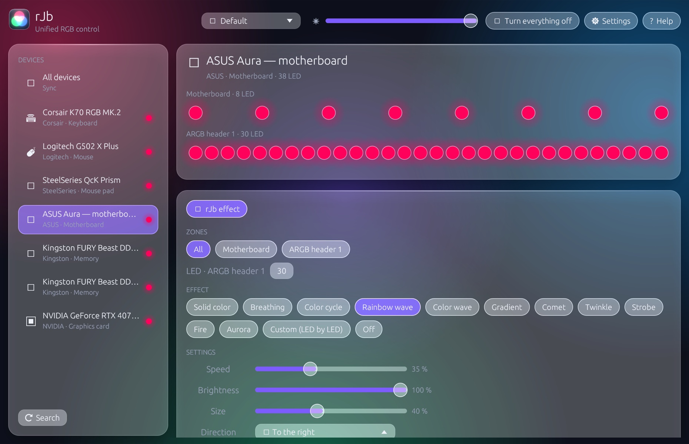

<p align="center"></p>

<h1 align="center">rJb</h1>

<p align="center"><b>L'illuminazione RGB di tutte le periferiche e i componenti in un'unica app leggera.</b></p>

<p align="center"> <a href="https://github.com/jeremdevgit/rjb/releases"></a> <a href="LICENSE"></a> <a href="https://github.com/jeremdevgit/rjb/actions/workflows/windows.yml"></a></p>

<p align="center"><a href="README.md">English</a> · <a href="README.fr.md">Français</a> · <a href="README.es.md">Español</a> · <a href="README.de.md">Deutsch</a> · <b>Italiano</b> · <a href="README.pt.md">Português</a> · <a href="README.zh.md">简体中文</a> · <a href="README.ja.md">日本語</a></p>

<p align="center"><a href="https://github.com/jeremdevgit/rjb/releases/latest"><b>⬇ Scarica</b></a></p>


Tastiere, mouse, cuffie, tappetini, RAM, scheda madre, scheda video, ventole e strisce LED: **un unico effetto sincronizzato, senza i pesanti software di ogni produttore.**

<p> </p>

*Screenshot con dispositivi dimostrativi, interfaccia reale e motore degli effetti reale.*

## In breve

| | |
|---|---|
| **Categoria** | 🛠️ Sistema e hardware |
| **Piattaforme** | Windows |
| **Interfaccia** | 8 lingue (EN, FR, ES, DE, IT, PT, ZH, JA) |
| **Prezzo** | Gratuito, open source, senza pubblicità né telemetria |
| **Stato** | Stabile |
| **Licenza** | [GPL-2.0-or-later](LICENSE) |

## Cosa fa

- **12 effetti sincronizzati**: colore fisso, respirazione, ciclo di colori, onda arcobaleno, onda di colore, sfumatura, cometa, scintillio, stroboscopio, fuoco, aurora e modifica LED per LED; luminosità globale, dispositivi ignorati.
- **Profili**, avvio all'accesso (con i permessi necessari per RAM e scheda madre), icona nell'area di notifica.
- **Rilevamento dei conflitti**: avvisa quando G HUB, iCUE, Synapse, Armoury Crate, SignalRGB o OpenRGB si contendono gli stessi dispositivi.

## Hardware supportato

| Famiglia | Esempi |
|---|---|
| Tastiere, mouse, cuffie, tappetini | Logitech, Corsair, Razer, SteelSeries, HyperX, Wooting, Illuminazione dinamica di Windows (LampArray) |
| RAM | Corsair, Kingston Fury, HyperX, Crucial Ballistix, G.Skill e altri moduli ENE / SPD |
| Schede madri e controller | ASUS Aura (USB), MSI Mystic Light, Gigabyte RGB Fusion 2, ASRock Polychrome, Corsair Commander Core / Lighting Node / Hydro Platinum, NZXT Hue 2, Lian Li |
| Schede video | NVIDIA (tramite il driver) e controller dei produttori di schede |

RAM e scheda madre passano dal bus SMBus con il driver libero e firmato **PawnIO** (lo stesso di OpenRGB e FanControl), proposto dall'installer. Senza, vengono gestiti solo i dispositivi USB.

## Installazione

1. Scarica `rJb-Setup.exe` dalla [versione più recente](https://github.com/jeremdevgit/rjb/releases/latest) ed eseguilo.
2. Una versione installata viene sostituita automaticamente; profili e impostazioni restano.
3. rJb si installa in *Program Files*, così l'attività elevata all'accesso punta a una cartella modificabile solo dagli amministratori.

Nessun certificato a pagamento: se compare SmartScreen, scegli **Ulteriori informazioni › Esegui comunque**. Verifica con `Get-FileHash .\rJb-Setup.exe` e `SHA256SUMS.txt`.

## Sicurezza e privacy

- **Nessuna connessione di rete** (a parte l'installazione facoltativa di PawnIO via winget e i link che apri), nessuna telemetria.
- L'accesso SMBus condivide il consueto blocco di sistema con altri software; le scritture sono limitate agli indirizzi dei controller riconosciuti.
- I link esterni si aprono con i tuoi permessi, mai come amministratore.

## Compilare

```powershell
# Rust stable + Visual Studio Build Tools (C++)
cargo build --release        # target\release\rJb.exe
.\tools\release.ps1          # dist\rJb-Setup.exe + controlli
```

I testi sono in [`src/textes.rs`](src/textes.rs) (chiave francese + sette traduzioni). Le versioni sono compilate da GitHub Actions ([`windows.yml`](.github/workflows/windows.yml)).

## Licenza

GNU GPL v2 o successiva — vedi [LICENSE](LICENSE). I protocolli dei dispositivi provengono dalla comunità [OpenRGB](https://gitlab.com/CalcProgrammer1/OpenRGB) (GPL-2.0-or-later); i moduli [PawnIO](https://github.com/namazso/PawnIO.Modules) inclusi sono LGPL-2.1 ([`licences-tiers/`](licences-tiers/)). I marchi appartengono ai rispettivi proprietari; rJb non è affiliato ad alcun produttore.

---

Hai trovato una vulnerabilità? Segnalala in privato (vedi [SECURITY.md](SECURITY.md)) e non in una issue pubblica.

## Altro software libero di jeremdevgit

Tutti gratuiti, open source e senza pubblicità.

**🛠️ Sistema e hardware** — [Boîte à outils](https://github.com/jeremdevgit/boite-a-outils) · [LJ Hub](https://github.com/jeremdevgit/lj-hub) · [Decklight](https://github.com/jeremdevgit/decklight)

**📒 Produttività e dati** — [Carnet de notes](https://github.com/jeremdevgit/carnet-rust) · [JMeca](https://github.com/jeremdevgit/jmeca) · [Suite Libre](https://jeremdevgit.github.io/suite-libre/)

**🎮 Musica e giochi** — [Pomme](https://github.com/jeremdevgit/pomme) · [Ludothèque](https://github.com/jeremdevgit/ludotheque) · [AutoDex](https://github.com/jeremdevgit/autodex) · [Batailles de France](https://github.com/jeremdevgit/batailles-de-france)
