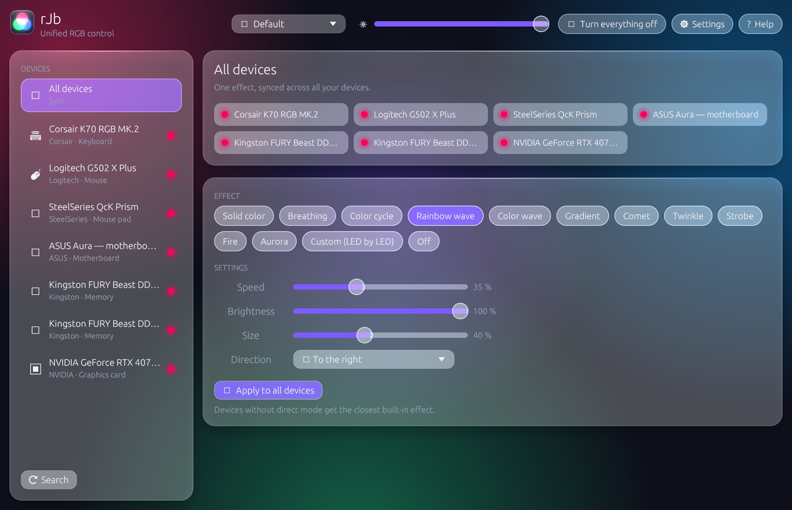

<p align="center"></p>

<h1 align="center">rJb</h1>

<p align="center"><b>すべての周辺機器とパーツの RGB ライティングを、ひとつの軽量アプリで。</b></p>

<p align="center"> <a href="https://github.com/jeremdevgit/rjb/releases"></a> <a href="LICENSE"></a> <a href="https://github.com/jeremdevgit/rjb/actions/workflows/windows.yml"></a></p>

<p align="center"><a href="README.md">English</a> · <a href="README.fr.md">Français</a> · <a href="README.es.md">Español</a> · <a href="README.de.md">Deutsch</a> · <a href="README.it.md">Italiano</a> · <a href="README.pt.md">Português</a> · <a href="README.zh.md">简体中文</a> · <b>日本語</b></p>

<p align="center"><a href="https://github.com/jeremdevgit/rjb/releases/latest"><b>⬇ ダウンロード</b></a></p>


キーボード、マウス、ヘッドセット、マウスパッド、メモリ、マザーボード、グラフィックボード、ファン、LED テープ：**メーカーごとの重いソフトなしで、ひとつの同期エフェクトに。**

<p> </p>

*スクリーンショットはデモ用デバイスで撮影。インターフェースとエフェクトエンジンは本物です。*

## 概要

| | |
|---|---|
| **カテゴリー** | 🛠️ システムとハードウェア |
| **対応環境** | Windows |
| **表示言語** | 8 言語（英・仏・西・独・伊・葡・中・日） |
| **価格** | 無料・オープンソース・広告なし・テレメトリーなし |
| **ステータス** | 安定版 |
| **ライセンス** | [GPL-2.0-or-later](LICENSE) |

## できること

- **12 種類の同期エフェクト**：固定色、呼吸、カラーサイクル、レインボーウェーブ、カラーウェーブ、グラデーション、彗星、きらめき、ストロボ、炎、オーロラ、LED 単位の編集。全体の明るさ、無視するデバイスの指定。
- **プロファイル**、サインイン時の自動起動（メモリとマザーボードに必要な権限付き）、通知領域のアイコン。
- **競合の検出**：G HUB、iCUE、Synapse、Armoury Crate、SignalRGB、OpenRGB が同じデバイスを取り合っていると警告します。

## 対応ハードウェア

| 種類 | 例 |
|---|---|
| キーボード、マウス、ヘッドセット、マウスパッド | Logitech、Corsair、Razer、SteelSeries、HyperX、Wooting、Windows ダイナミック ライティング（LampArray） |
| メモリ | Corsair、Kingston Fury、HyperX、Crucial Ballistix、G.Skill ほか ENE / SPD モジュール |
| マザーボードとコントローラー | ASUS Aura（USB）、MSI Mystic Light、Gigabyte RGB Fusion 2、ASRock Polychrome、Corsair Commander Core / Lighting Node / Hydro Platinum、NZXT Hue 2、Lian Li |
| グラフィックボード | NVIDIA（ドライバー経由）と各ボードメーカーのコントローラー |

メモリとマザーボードのライティングは、署名済みのオープンソースドライバー **PawnIO**（OpenRGB や FanControl でも使用）を通じて SMBus で制御します。インストーラーで導入を選べます。なければ USB デバイスのみ制御します。

## インストール

1. [最新リリース](https://github.com/jeremdevgit/rjb/releases/latest)から `rJb-Setup.exe` をダウンロードして実行します。
2. インストール済みのバージョンは自動的に置き換えられ、プロファイルと設定は保持されます。
3. rJb は *Program Files* にインストールされるため、管理者権限で起動するサインインタスクは管理者しか変更できないフォルダーを指します。

有料証明書の署名はありません。SmartScreen が表示されたら **詳細情報 › 実行** を選んでください。`Get-FileHash .\rJb-Setup.exe` と `SHA256SUMS.txt` で確認できます。

## 安全性とプライバシー

- **ネットワーク接続なし**（winget による PawnIO の任意インストールと、自分で開くリンクを除く）、テレメトリーなし。
- SMBus へのアクセスは他のソフトと共通のシステムロックを使い、書き込みは認識済みコントローラーのアドレスに限られます。
- 外部リンクは管理者ではなくユーザー権限で開きます。

## ソースからビルド

```powershell
# Rust stable + Visual Studio Build Tools (C++)
cargo build --release        # target\release\rJb.exe
.\tools\release.ps1          # dist\rJb-Setup.exe + チェック
```

テキストは [`src/textes.rs`](src/textes.rs) にあります（フランス語をキーに 7 言語の訳）。公開版は GitHub Actions でビルドしています（[`windows.yml`](.github/workflows/windows.yml)）。

## ライセンス

GNU GPL v2 以降 — [LICENSE](LICENSE) を参照。デバイスのプロトコルは [OpenRGB](https://gitlab.com/CalcProgrammer1/OpenRGB) コミュニティの成果（GPL-2.0-or-later）に基づきます。同梱の [PawnIO](https://github.com/namazso/PawnIO.Modules) モジュールは LGPL-2.1 です（[`licences-tiers/`](licences-tiers/)）。記載のブランドは各所有者のものであり、rJb はどのメーカーとも提携していません。

---

脆弱性を見つけたら、公開 Issue ではなく非公開で報告してください（[SECURITY.md](SECURITY.md) を参照）。

## jeremdevgit のその他のフリーソフトウェア

すべて無料・オープンソース・広告なし。

**🛠️ システムとハードウェア** — [Boîte à outils](https://github.com/jeremdevgit/boite-a-outils) · [LJ Hub](https://github.com/jeremdevgit/lj-hub) · [Decklight](https://github.com/jeremdevgit/decklight)

**📒 生産性とデータ** — [Carnet de notes](https://github.com/jeremdevgit/carnet-rust) · [JMeca](https://github.com/jeremdevgit/jmeca) · [Suite Libre](https://jeremdevgit.github.io/suite-libre/)

**🎮 音楽とゲーム** — [Pomme](https://github.com/jeremdevgit/pomme) · [Ludothèque](https://github.com/jeremdevgit/ludotheque) · [AutoDex](https://github.com/jeremdevgit/autodex) · [Batailles de France](https://github.com/jeremdevgit/batailles-de-france)
