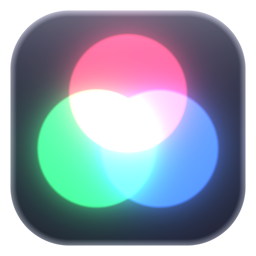
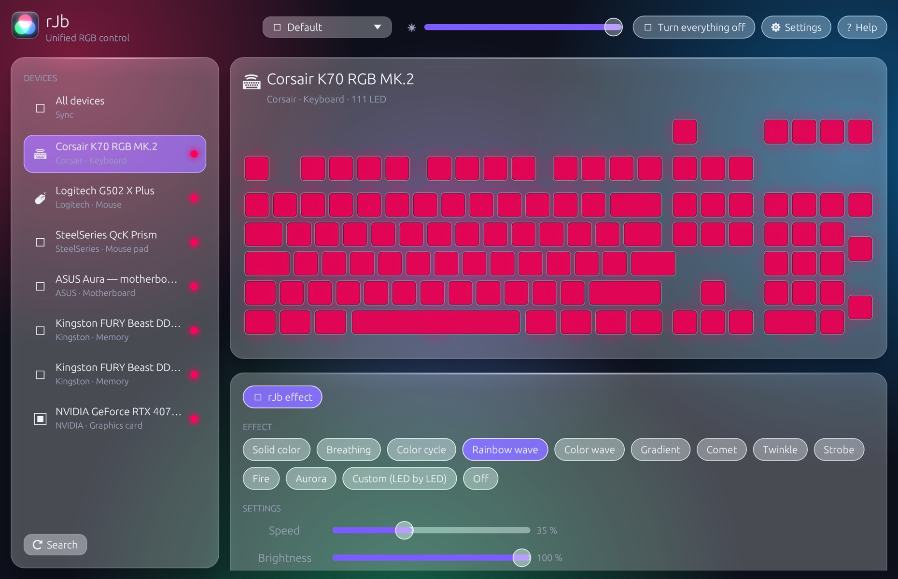
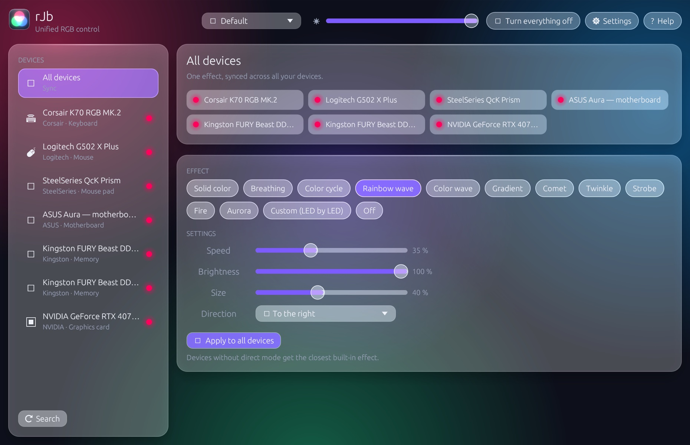
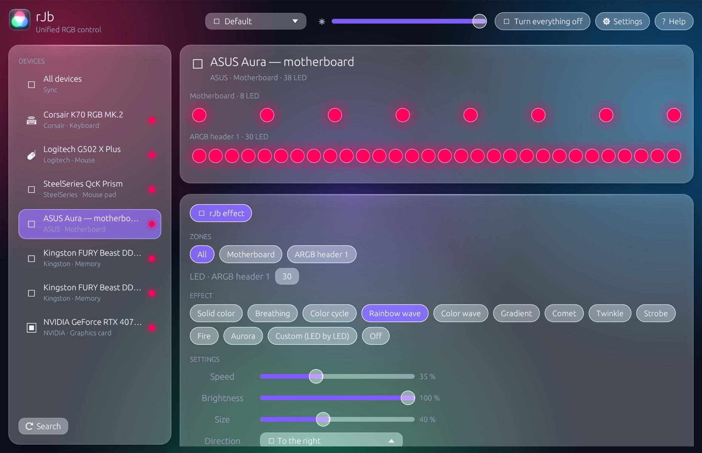
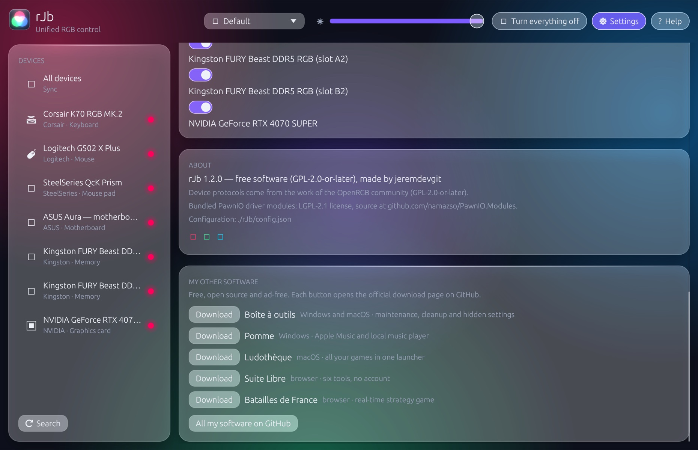

<p align="center"></p>

# rJb

**English** · [Français](README.fr.md) · [Español](README.es.md)

**RGB lighting for all your peripherals and components in one lightweight app for Windows.** Keyboards, mice, headsets, mousepads, RAM, motherboard, graphics card, fans and LED strips: one synchronized effect, without each manufacturer's heavy software.

**8 languages**: English, French, Spanish, German, Italian, Portuguese, Chinese and Japanese. Your Windows language is picked automatically; *Settings › Language* lets you switch (instantly, no restart needed).

👉 **[Download rJb for Windows](https://github.com/jeremdevgit/rjb/releases/latest)** (`rJb-Setup.exe`)



<p> </p>
<p></p>

*Screenshots taken with demo devices: the real interface and the real effects engine, with no hardware plugged in.*

## Supported devices

| Family | Examples |
|---|---|
| Keyboards, mice, headsets, mousepads | Logitech, Corsair, Razer, SteelSeries, HyperX, Wooting, Windows "Dynamic Lighting" / LampArray devices |
| RAM | Corsair, Kingston Fury, HyperX, Crucial Ballistix, G.Skill and other ENE / SPD modules |
| Motherboards and controllers | ASUS Aura (USB), MSI Mystic Light, Gigabyte RGB Fusion 2, ASRock Polychrome, Corsair Commander Core / Lighting Node / Hydro Platinum, NZXT Hue 2, Lian Li |
| Graphics cards | NVIDIA (through the NVIDIA driver) and the card manufacturers' controllers |

RAM and motherboard go through the SMBus, thanks to the signed open-source **PawnIO** driver (the same one used by OpenRGB and FanControl), optionally installed by the installer. Without it, only USB devices are controlled.

## Features

- 12 effects synchronized across all devices: static color, breathing, color cycle, rainbow wave, color wave, gradient, comet, twinkle, strobe, fire, aurora, and LED-by-LED editing; global brightness, ignored devices.
- Profiles, launch at startup (with the rights needed for RAM and motherboard), notification area icon.
- Detection of competing software (G HUB, iCUE, Synapse, Armoury Crate, SignalRGB, OpenRGB…) fighting over the same devices.

## Installing

1. Download `rJb-Setup.exe` from the [Releases](https://github.com/jeremdevgit/rjb/releases/latest) and run it.
2. **An already installed version is replaced automatically** (the old version's files are removed, even if it was in another folder); profiles and settings are kept.
3. rJb installs into *Program Files*: the task that launches it as administrator at sign-in is only created in a folder that only administrators can modify.

The executable isn't signed with a paid certificate: if Windows SmartScreen shows "Windows protected your PC", click **More info** then **Run anyway**. To check the file: `Get-FileHash .\rJb-Setup.exe` and compare with `SHA256SUMS.txt`.

## Privacy and security

- **No network connection** (apart from the optional PawnIO install through winget and the links opened in your browser), no telemetry.
- SMBus access shared with other software through the usual system lock; writes limited to the addresses of recognized controllers.
- External links opened with the user's rights, never as administrator.

Found a vulnerability? Please read [SECURITY.md](SECURITY.md).

## Building

Requirements: stable [Rust](https://rustup.rs) and the Visual Studio *Build Tools* ("Desktop development with C++").

```powershell
cargo build --release          # target\release\rJb.exe (renamed rJb-Setup.exe, it installs)
.\tools\release.ps1            # dist\rJb-Setup.exe + checks
```

Released versions are built by GitHub Actions ([`.github/workflows/windows.yml`](.github/workflows/windows.yml)).

## Translations

Texts are in [`src/textes.rs`](src/textes.rs): one line per text, the French text being the key, followed by the seven translations. English is the fallback when the Windows language isn't available. For Chinese and Japanese, the matching Windows font is loaded (Microsoft YaHei, Yu Gothic…).

## Repository layout

```
src/drivers/   one driver per device family (HID, SMBus, NVAPI…)
src/           effects engine, configuration, interface (egui), installer
assets/pawnio/ compiled modules of the PawnIO driver (SMBus access)
tools/         building the distributed version
licences-tiers/ third-party component licenses
```

## License

Code under the **GNU GPL v2 or later** — see [LICENSE](LICENSE). Copyright © 2026 jeremdevgit.

Device protocols come from the work of the [OpenRGB](https://gitlab.com/CalcProgrammer1/OpenRGB) community (GPL-2.0-or-later), hence rJb's license. The included [PawnIO](https://github.com/namazso/PawnIO.Modules) modules are under the LGPL-2.1 (folder [licences-tiers](licences-tiers/)). The brands mentioned belong to their owners; rJb isn't affiliated with any manufacturer.

## My other software

All free, open source and ad-free — [github.com/jeremdevgit](https://github.com/jeremdevgit):

| Software | For | In short |
|---|---|---|
| [Boîte à outils](https://github.com/jeremdevgit/boite-a-outils) | Windows, macOS | maintenance, cleanup and hidden settings |
| [Pomme](https://github.com/jeremdevgit/pomme) | Windows | Apple Music and local music player |
| [Ludothèque](https://github.com/jeremdevgit/ludotheque) | macOS | all your games in one launcher |
| [Suite Libre](https://jeremdevgit.github.io/suite-libre/) | browser | six tools, no account: QR codes, blur, photos, conversions, averages, passwords |
| [Batailles de France](https://github.com/jeremdevgit/batailles-de-france) | browser | real-time strategy game on the maps of five French cities |
