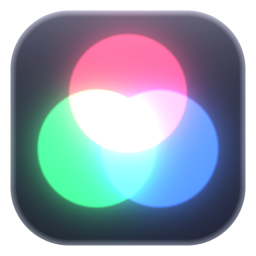

<p align="center"></p>

<h1 align="center">rJb</h1>

<p align="center"><b>A iluminação RGB de todos os seus periféricos e componentes numa única aplicação leve.</b></p>

<p align="center"> <a href="https://github.com/jeremdevgit/rjb/releases"></a> <a href="LICENSE"></a> <a href="https://github.com/jeremdevgit/rjb/actions/workflows/windows.yml"></a></p>

<p align="center"><a href="README.md">English</a> · <a href="README.fr.md">Français</a> · <a href="README.es.md">Español</a> · <a href="README.de.md">Deutsch</a> · <a href="README.it.md">Italiano</a> · <b>Português</b> · <a href="README.zh.md">简体中文</a> · <a href="README.ja.md">日本語</a></p>

<p align="center"><a href="https://github.com/jeremdevgit/rjb/releases/latest"><b>⬇ Transferir</b></a></p>


Teclados, ratos, auscultadores, tapetes, RAM, placa-mãe, placa gráfica, ventoinhas e fitas LED: **um único efeito sincronizado, sem o software pesado de cada fabricante.**

<p> </p>

*Capturas com dispositivos de demonstração, a interface real e o motor de efeitos real.*

## Em resumo

| | |
|---|---|
| **Categoria** | 🛠️ Sistema e hardware |
| **Plataformas** | Windows |
| **Interface** | 8 idiomas (EN, FR, ES, DE, IT, PT, ZH, JA) |
| **Preço** | Gratuito, de código aberto, sem anúncios nem telemetria |
| **Estado** | Estável |
| **Licença** | [GPL-2.0-or-later](LICENSE) |

## O que faz

- **12 efeitos sincronizados**: cor fixa, respiração, ciclo de cores, onda arco-íris, onda de cor, gradiente, cometa, cintilação, estroboscópio, fogo, aurora e edição LED a LED; brilho global, dispositivos ignorados.
- **Perfis**, arranque com a sessão (com os direitos necessários para RAM e placa-mãe), ícone na área de notificação.
- **Deteção de conflitos**: avisa quando G HUB, iCUE, Synapse, Armoury Crate, SignalRGB ou OpenRGB disputam os mesmos dispositivos.

## Hardware compatível

| Família | Exemplos |
|---|---|
| Teclados, ratos, auscultadores, tapetes | Logitech, Corsair, Razer, SteelSeries, HyperX, Wooting, Iluminação dinâmica do Windows (LampArray) |
| RAM | Corsair, Kingston Fury, HyperX, Crucial Ballistix, G.Skill e outros módulos ENE / SPD |
| Placas-mãe e controladores | ASUS Aura (USB), MSI Mystic Light, Gigabyte RGB Fusion 2, ASRock Polychrome, Corsair Commander Core / Lighting Node / Hydro Platinum, NZXT Hue 2, Lian Li |
| Placas gráficas | NVIDIA (através do controlador) e controladores dos fabricantes de placas |

A RAM e a placa-mãe usam o barramento SMBus com o controlador livre e assinado **PawnIO** (o mesmo do OpenRGB e do FanControl), proposto pelo instalador. Sem ele, só os dispositivos USB são controlados.

## Instalar

1. Transfira `rJb-Setup.exe` da [versão mais recente](https://github.com/jeremdevgit/rjb/releases/latest) e execute-o.
2. Uma versão instalada é substituída automaticamente; perfis e definições mantêm-se.
3. O rJb instala-se em *Program Files*, para que a tarefa elevada de início de sessão aponte para uma pasta que só os administradores podem alterar.

Sem certificado pago: se o SmartScreen aparecer, escolha **Mais informações › Executar mesmo assim**. Verifique com `Get-FileHash .\rJb-Setup.exe` e `SHA256SUMS.txt`.

## Segurança e privacidade

- **Sem ligação de rede** (exceto a instalação opcional do PawnIO via winget e as ligações que abrir), sem telemetria.
- O acesso SMBus partilha o bloqueio habitual do sistema com outros programas; as escritas limitam-se a endereços de controladores reconhecidos.
- As ligações externas abrem com os seus direitos, nunca como administrador.

## Compilar

```powershell
# Rust estável + Visual Studio Build Tools (C++)
cargo build --release        # target\release\rJb.exe
.\tools\release.ps1          # dist\rJb-Setup.exe + verificações
```

Os textos estão em [`src/textes.rs`](src/textes.rs) (chave em francês + sete traduções). As versões são compiladas pelo GitHub Actions ([`windows.yml`](.github/workflows/windows.yml)).

## Licença

GNU GPL v2 ou posterior — ver [LICENSE](LICENSE). Os protocolos dos dispositivos vêm da comunidade [OpenRGB](https://gitlab.com/CalcProgrammer1/OpenRGB) (GPL-2.0-or-later); os módulos [PawnIO](https://github.com/namazso/PawnIO.Modules) incluídos são LGPL-2.1 ([`licences-tiers/`](licences-tiers/)). As marcas pertencem aos seus proprietários; o rJb não está afiliado a nenhum fabricante.

---

Encontrou uma vulnerabilidade? Comunique-a em privado (consulte [SECURITY.md](SECURITY.md)) e não num issue público.

## Mais software livre de jeremdevgit

Todos gratuitos, de código aberto e sem anúncios.

**🛠️ Sistema e hardware** — [Boîte à outils](https://github.com/jeremdevgit/boite-a-outils) · [LJ Hub](https://github.com/jeremdevgit/lj-hub) · [Decklight](https://github.com/jeremdevgit/decklight)

**📒 Produtividade e dados** — [Carnet de notes](https://github.com/jeremdevgit/carnet-rust) · [JMeca](https://github.com/jeremdevgit/jmeca) · [Suite Libre](https://jeremdevgit.github.io/suite-libre/)

**🎮 Música e jogos** — [Pomme](https://github.com/jeremdevgit/pomme) · [Ludothèque](https://github.com/jeremdevgit/ludotheque) · [AutoDex](https://github.com/jeremdevgit/autodex) · [Batailles de France](https://github.com/jeremdevgit/batailles-de-france)
