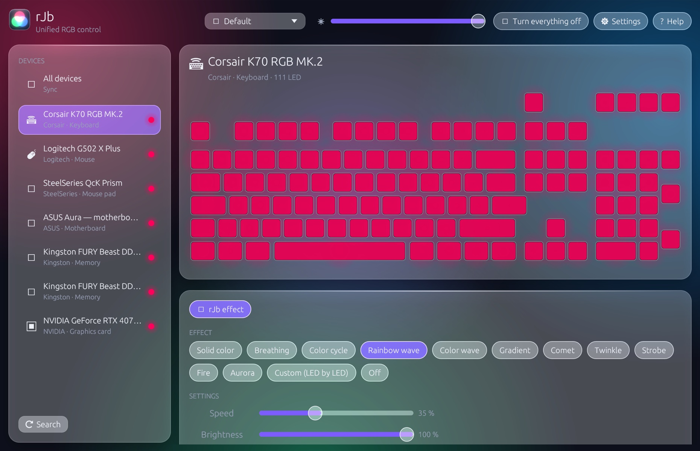

<p align="center"></p>

<h1 align="center">rJb</h1>

<p align="center"><b>用一个轻量应用控制所有外设和硬件的 RGB 灯效。</b></p>

<p align="center"> <a href="https://github.com/jeremdevgit/rjb/releases"></a> <a href="LICENSE"></a> <a href="https://github.com/jeremdevgit/rjb/actions/workflows/windows.yml"></a></p>

<p align="center"><a href="README.md">English</a> · <a href="README.fr.md">Français</a> · <a href="README.es.md">Español</a> · <a href="README.de.md">Deutsch</a> · <a href="README.it.md">Italiano</a> · <a href="README.pt.md">Português</a> · <b>简体中文</b> · <a href="README.ja.md">日本語</a></p>

<p align="center"><a href="https://github.com/jeremdevgit/rjb/releases/latest"><b>⬇ 下载</b></a></p>



键盘、鼠标、耳机、鼠标垫、内存、主板、显卡、风扇和灯带：**统一的同步灯效，无需安装各家厂商的臃肿软件。**

<p> </p>

*截图使用演示设备，界面和灯效引擎均为真实效果。*

## 概览

| | |
|---|---|
| **类别** | 🛠️ 系统与硬件 |
| **平台** | Windows |
| **界面语言** | 8 种语言（英、法、西、德、意、葡、中、日） |
| **价格** | 免费、开源、无广告、无遥测 |
| **状态** | 稳定版 |
| **许可证** | [GPL-2.0-or-later](LICENSE) |

## 功能

- **12 种同步灯效**：常亮、呼吸、色彩循环、彩虹波浪、色彩波浪、渐变、彗星、闪烁、频闪、火焰、极光，以及逐颗 LED 编辑；全局亮度、忽略设备。
- **配置文件**、登录时启动（带有控制内存和主板所需的权限）、通知区域图标。
- **冲突检测**：当 G HUB、iCUE、Synapse、Armoury Crate、SignalRGB 或 OpenRGB 争抢同一设备时发出提醒。

## 支持的硬件

| 类别 | 示例 |
|---|---|
| 键盘、鼠标、耳机、鼠标垫 | Logitech、Corsair、Razer、SteelSeries、HyperX、Wooting、Windows 动态照明（LampArray） |
| 内存 | Corsair、Kingston Fury、HyperX、Crucial Ballistix、G.Skill 及其他 ENE / SPD 模块 |
| 主板与控制器 | ASUS Aura（USB）、MSI Mystic Light、Gigabyte RGB Fusion 2、ASRock Polychrome、Corsair Commander Core / Lighting Node / Hydro Platinum、NZXT Hue 2、Lian Li |
| 显卡 | NVIDIA（通过驱动）以及各显卡厂商的控制器 |

内存和主板灯光通过 SMBus 控制，使用开源且已签名的 **PawnIO** 驱动（OpenRGB 和 FanControl 也在用），可在安装时选择安装。没有它时只能控制 USB 设备。

## 安装

1. 从[最新版本](https://github.com/jeremdevgit/rjb/releases/latest)下载 `rJb-Setup.exe` 并运行。
2. 已安装的版本会被自动替换，配置文件和设置都会保留。
3. rJb 安装在 *Program Files* 中，因此以管理员身份运行的登录任务指向只有管理员能修改的文件夹。

未使用付费证书签名：如出现 SmartScreen，请选择 **更多信息 › 仍要运行**。用 `Get-FileHash .\rJb-Setup.exe` 对照 `SHA256SUMS.txt` 校验。

## 安全与隐私

- **不联网**（可选通过 winget 安装 PawnIO 以及你主动打开的链接除外），无遥测。
- SMBus 访问与其他软件共用系统的标准锁；写入仅限已识别控制器的地址。
- 外部链接以你的权限打开，绝不以管理员身份。

## 从源码构建

```powershell
# Rust stable + Visual Studio Build Tools (C++)
cargo build --release        # target\release\rJb.exe
.\tools\release.ps1          # dist\rJb-Setup.exe + 检查
```

文本位于 [`src/textes.rs`](src/textes.rs)（以法语为键，附七种译文）。发布版本由 GitHub Actions 构建（[`windows.yml`](.github/workflows/windows.yml)）。

## 许可证

GNU GPL v2 或更高版本，见 [LICENSE](LICENSE)。设备协议来自 [OpenRGB](https://gitlab.com/CalcProgrammer1/OpenRGB) 社区（GPL-2.0-or-later）；附带的 [PawnIO](https://github.com/namazso/PawnIO.Modules) 模块采用 LGPL-2.1（[`licences-tiers/`](licences-tiers/)）。文中品牌归其所有者；rJb 与任何厂商均无关联。

---

发现安全漏洞？请私下报告（见 [SECURITY.md](SECURITY.md)），不要发公开 issue。

## jeremdevgit 的其他自由软件

全部免费、开源、无广告。

**🛠️ 系统与硬件** — [Boîte à outils](https://github.com/jeremdevgit/boite-a-outils) · [LJ Hub](https://github.com/jeremdevgit/lj-hub) · [Decklight](https://github.com/jeremdevgit/decklight)

**📒 效率与数据** — [Carnet de notes](https://github.com/jeremdevgit/carnet-rust) · [JMeca](https://github.com/jeremdevgit/jmeca) · [Suite Libre](https://jeremdevgit.github.io/suite-libre/)

**🎮 音乐与游戏** — [Pomme](https://github.com/jeremdevgit/pomme) · [Ludothèque](https://github.com/jeremdevgit/ludotheque) · [AutoDex](https://github.com/jeremdevgit/autodex) · [Batailles de France](https://github.com/jeremdevgit/batailles-de-france)
